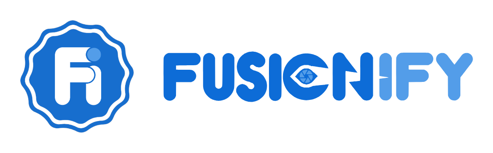

<p align="center">
  
</p>

<h1 align="center">FUSIONIFY UI</h1>

<p align="center">
  Sistem desain resmi semua web FUSIONIFY.<br>
  Token, komponen CSS, gerak, segel, font, logo, dan maskot, diambil dari <a href="https://fusionify.id">fusionify.id</a>.
</p>

---

## Untuk apa

Supaya **web company dan semua web brand produk** (Premiumify, FUSIONIFY BOT, StudyDate.id, Fusionify Solutions, dan produk berikutnya) terasa satu keluarga, siapa pun yang mengerjakan: kamu, tim, atau AI agent.

Setiap AI agent (Claude, ChatGPT/Codex, Cursor, Copilot, Gemini) otomatis membaca `AGENTS.md` dan `DESIGN.md` di repo ini.

## Mulai cepat

```bash
# 1. Taruh kit di proyek
git submodule add https://github.com/FUSIONIFY-ID/Fusionify_UI public/fusionify-ui
# atau salin foldernya saja

# 2. Pasang mesin gerak
npm i gsap lenis
```

```html
<head>
  <!-- isi snippets/head-script.html -->
  <link rel="preload" href="/fusionify-ui/fonts/afacad-flux-latin-wght-normal.woff2" as="font" type="font/woff2" crossorigin>
  <link rel="preload" href="/fusionify-ui/fonts/sansation-latin-400-normal.woff2" as="font" type="font/woff2" crossorigin>
  <link rel="stylesheet" href="/fusionify-ui/css/fusionify.css">
</head>
<body>
  <!-- isi snippets/sprite.html -->

  <section class="sec">
    <div class="wrap">
      <span class="kicker">Produk</span>
      <h2 class="h-sec split" data-split>Fuse ideas<span class="dot">.</span></h2>
      <a class="btn" href="#">Mulai</a> <span class="chip beta">Beta</span>
    </div>
  </section>

  <!-- isi snippets/body-parts.html -->
  <script type="module">
    import { initFusionify } from "/fusionify-ui/js/motion.js";
    const fy = initFusionify();
  </script>
</body>
```

Buka **`demo/index.html`** (lewat server lokal, mis. `npx serve .`) untuk melihat semua komponen dan contoh markup-nya.

Mau bikin web produk baru? Salin **`templates/landing-produk.html`**, ganti teks bertanda `GANTI`, logo produk, dan status chip-nya. Isinya sudah lengkap: hero dengan maskot, fitur, cara kerja, harga, testimoni (hapus kalau belum ada izin), FAQ, ajakan, form, dan footer dengan badge.

## Halaman aplikasi dan mode gelap

```html
<link rel="stylesheet" href="/fusionify-ui/css/fusionify.css">
<link rel="stylesheet" href="/fusionify-ui/css/app.css">   <!-- hanya di dashboard, admin, masuk -->
...
<script type="module">
  import { initApp } from "/fusionify-ui/js/app.js";
  const app = initApp();
</script>
```

Template siap pakai: `templates/auth/masuk.html`, `daftar.html`, `lupa-password.html`, `atur-ulang-password.html`, `templates/dashboard.html`, `templates/admin.html`.

Mode gelap otomatis mengikuti sistem. Tambahkan tombol `<button class="icon-btn theme-btn" data-theme-toggle ...>` (contoh di template) supaya pengguna bisa memilih sendiri. Web yang ingin selalu terang: `<html data-theme="light" data-theme-lock>`.

## Aplikasi HP (web HP, PWA, iOS, Android)

- **Isinya HTML** (PWA, Capacitor, WebView): mulai dari `templates/app-mobile.html` dan tempel `snippets/pwa-head.html`. Semua komponen HP ada: app bar, navigation bar bawah, rail tablet, FAB, bottom sheet, side sheet, carousel, slider, date/time picker, tooltip, snackbar, chip filter, list, skeleton. Katalognya di `templates/komponen.html`. Template siap pakai: `app-mobile.html` (beranda), `chat.html` (pesan), `acara.html` (detail acara), `auth/verifikasi.html` (kode OTP).
- **Native** (Flutter, SwiftUI, Jetpack Compose, React Native, Android Kotlin/Java dengan XML): pakai token di `tokens/` beserta huruf TTF. File Flutter sudah dicek dengan `flutter analyze` dan `flutter build`. Panduan lengkap di `tokens/README.md`.

## Library Figma

Untuk desainer: **[FUSIONIFY UI · Library di Figma](https://www.figma.com/design/av0M9IuzYKJTiUWJsYTS3i)**. Isinya variabel warna (mode Terang dan Gelap), radius, jarak, gaya teks, bayangan stiker, ikon, dan komponen yang sama dengan kode. Setiap variabel punya kode untuk web (`var(--blue)`), Android, dan iOS, jadi di Dev Mode programmer langsung melihat nama token yang benar.

Kalau token di `css/tokens.css` berubah, samakan juga variabel di Figma (dan sebaliknya). Jangan membuat warna baru hanya di salah satu sisi.

## Domain resmi

Kit ini hanya berjalan di `fusionify.id`, `fusionify.biz.id`, domain partner `premiumify.my.id` dan `studydate.id`, serta subdomain semuanya (lihat `js/lisensi.js`). Untuk pengembangan, `localhost`, `127.0.0.1`, `*.local`, dan file yang dibuka langsung tetap jalan. Menambah domain partner: tulis di `DOMAIN_RESMI`, catat di CHANGELOG, lalu rilis versi baru.

## Versi

Kit ini dirilis bernomor versi (`1.5.0`, `1.6.0`, dst.). Web produk **mengunci** satu versi, jadi perubahan di kit tidak ikut merusak web yang sudah jalan. Update dilakukan sengaja.

- **Git submodule** (disarankan):
  ```
  git submodule add https://github.com/FUSIONIFY-ID/Fusionify_UI public/fusionify-ui
  cd public/fusionify-ui
  git checkout v1.5.0
  ```
  Naik versi nanti: `git fetch --tags` lalu `git checkout v1.6.0`, cek web-nya, commit.
- **npm dari GitHub**: `npm i github:FUSIONIFY-ID/Fusionify_UI#v1.5.0`. Karena repo privat, mesin build perlu akses ke repo (token GitHub).
- **Zip**: unduh `Fusionify_UI-v1.5.0.zip` dari halaman Releases.

Aturan nomor: angka terakhir (1.5.**1**) untuk perbaikan kecil yang aman, angka tengah (1.**6**.0) untuk komponen baru yang tidak merusak, angka depan (**2**.0.0) kalau ada kelas atau markup yang berubah dan web produk perlu disesuaikan. Semua perubahan dicatat di `CHANGELOG.md`.

Cara merilis: ubah `version` di `package.json`, tambah bagian baru di `CHANGELOG.md`, lalu jalankan `npm run release` dan ikuti perintahnya. GitHub Actions akan menguji, membuat zip, dan menerbitkan rilisnya.

## Uji otomatis

```
npm install
npx playwright install chromium
npm test
```

Yang dicek: semua template di 8 ukuran layar (375 sampai 1920), tema terang dan gelap, kontras dengan axe, layar sentuh (target sentuh dan scroll samping), tanpa JavaScript, kurangi gerakan, dan semua interaksi komponen. Uji yang sama jalan otomatis di GitHub setiap ada push (`.github/workflows/uji.yml`). Kalau tanda centang di commit jadi merah, buka tab Actions untuk melihat bagian yang rusak.

## Dipakai di AI agent mana pun

| Agent | Cara membaca aturan repo ini |
| --- | --- |
| Codex / ChatGPT agent, Cursor, Windsurf, GitHub Copilot (coding agent), Jules, Zed, Aider, Junie, Amp, opencode, dan lainnya | Otomatis membaca `AGENTS.md` |
| Grok (Grok Build) | Otomatis membaca `AGENTS.md` dan `CLAUDE.md`, juga `.cursor/rules/` |
| Claude Code | `CLAUDE.md` (menunjuk ke `AGENTS.md` dan `DESIGN.md`) |
| Gemini CLI | `.gemini/settings.json` sudah diatur membaca `AGENTS.md` + `GEMINI.md` |
| Qwen Code | `.qwen/settings.json` sudah diatur membaca `AGENTS.md` + `QWEN.md` |
| Copilot di editor | `.github/copilot-instructions.md` |
| Cursor (aturan lama) | `.cursor/rules/*.mdc` |
| Aider | `.aider.conf.yml` membaca `AGENTS.md` dan `DESIGN.md` |
| **AI versi chat web** (ChatGPT, Gemini, Grok, Qwen, Claude di browser) | Tidak bisa membaca repo. **Upload `FUSIONIFY-UI-KONTEKS.md`** ke chat, lalu tulis permintaan |

`FUSIONIFY-UI-KONTEKS.md` dibuat otomatis dari `AGENTS.md`, `DESIGN.md`, semua CSS, dan snippet. Setiap kali salah satunya berubah, jalankan `node scripts/build-konteks.mjs`.

## Isi

| Folder | Isi |
| --- | --- |
| `css/` | `tokens.css` (termasuk mode gelap), `base.css`, `components.css`, `product.css` (komponen web produk), `controls.css` (kontrol web dan aplikasi HP), `app.css` (dashboard, admin, masuk), `fusionify.css` (semua kecuali app.css) |
| `js/` | `motion.js` (`initFusionify`, web publik), `app.js` (`initApp`, aplikasi), `controls.js` (`initControls`, `snackbar`), `theme.js` (terang/gelap), `seal.js` (`seal`, `SEAL_PATH`) |
| `snippets/` | Potongan HTML wajib: head, sprite SVG, kursor/toast/tirai, plus `pwa-head.html` dan `manifest.webmanifest` untuk aplikasi HP |
| `tokens/` | Token dan huruf untuk aplikasi native (Flutter, SwiftUI, Compose, React Native) |
| `fonts/` | Afacad Flux, Sansation, Caveat, Exo 2 (woff2, OFL) |
| `brand/` | Segel Fi, wordmark, emblem, logo horizontal/vertikal/legacy |
| `mascot/` | Maskot badan penuh, kepala, papan, stiker bot |
| `badge/` | "Sebuah produk dari FUSIONIFY" ID/EN, terang/gelap |
| `demo/` | Halaman contoh semua komponen |
| `templates/` | Halaman siap pakai: `landing-produk.html`, `404.html`, `auth/` (masuk, daftar, lupa password, atur ulang), `dashboard.html`, `admin.html` |

## Atribut data yang dipahami `initFusionify()`

| Atribut | Efek |
| --- | --- |
| `data-split` | Judul naik per kata |
| `data-reveal` | Naik dan memudar masuk saat terlihat |
| `data-assemble` | Anak-anak elemen "dirakit" dari posisi acak (jangan untuk elemen yang punya transform saat hover) |
| `data-count-to="120" data-suffix="+"` | Angka naik |
| `data-magnetic` | Efek magnet ke kursor |
| `data-copy="teks" data-copied="pesan"` | Salin ke clipboard + toast |
| `data-cursor-label="lihat"` | Label tulisan tangan di kursor |
| `data-sfx="plop"` | Bunyi saat diklik (kalau suara dinyalakan) |
| `data-nav`, `data-menu`, `data-drawer`, `data-sound` | Nav, menu HP, tombol suara |
| `data-no-veil` | Tautan ini tidak memakai transisi segel |
| `data-pause` | Elemen tambahan yang animasinya dijeda saat di luar layar |

## Aturan singkat

- Pakai token, jangan bikin warna atau font baru.
- Logo dari `brand/`, jangan diketik ulang. Web produk boleh pakai logonya sendiri.
- Maskot: tukar gambar badan penuh, jangan tempel kepala.
- Status produk jujur, tanpa angka atau testimoni karangan.
- Hanya animasikan `transform` dan `opacity`.
- Tanpa em dash di teks pengunjung.

Lengkapnya di **[`AGENTS.md`](AGENTS.md)** dan **[`DESIGN.md`](DESIGN.md)**.

## Lisensi

Kode untuk proyek FUSIONIFY. Logo, maskot, dan badge milik PT FUSIONIFY DIGITAL STORE. Font OFL. Detail di [`LICENSE.md`](LICENSE.md) dan [`THIRD_PARTY_NOTICES.md`](THIRD_PARTY_NOTICES.md).

<p align="center"><br><sub>© 2026 PT FUSIONIFY DIGITAL STORE · Bogor · <a href="https://fusionify.id">fusionify.id</a></sub></p>
